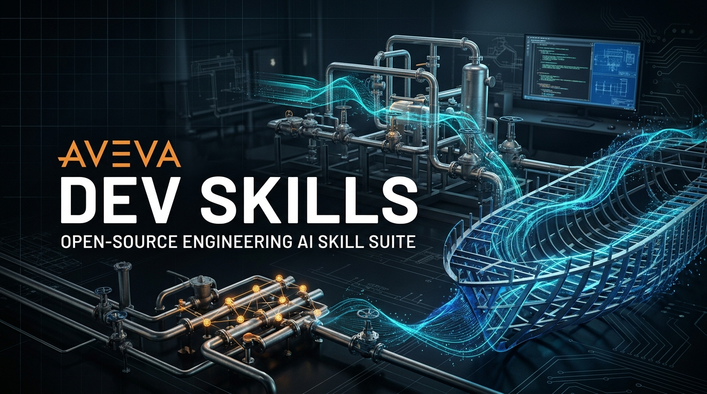

<p align="center">
  
</p>

# AVEVA Dev Skills 🚀

[English](README.md) | [简体中文](README_zh.md) | [实测基准 (Evals)](EVALS_zh.md)

[](https://agentskills.io)
[](LICENSE)
[](https://opencode.ai)
[](https://claude.ai)
[](https://deepmind.google)
[](https://github.com/cline/cline)

**AVEVA Dev Skills** 是专为 AI 编程智能体（AI Coding Agents）打造的 **AVEVA Marine 与 AVEVA PDMS 二次开发工程知识库与专业技能套件**。

本项目遵循开放的 **[Agent Skills 规范](https://agentskills.io)**，采用 **渐进式披露（Progressive Disclosure）** 架构设计。考虑到 AVEVA 二次开发中 **.NET 现代托管插件开发** 与 **PML 传统脚本/界面自动化** 属于两种截然不同的工程场景，本项目将两者拆分为两个独立的专业技能包，既可作为整套开发套件引入，也可按实际开发场景单独使用。

---

## 📦 技能模块概览 (Skills in this Suite)

### 场景一：`aveva-dev-dotnet` — .NET 二次开发与架构体系
> 路径: [`skills/aveva-dev-dotnet/`](skills/aveva-dev-dotnet/SKILL.md)  
> 覆盖规模: 10 大核心章节 + 4 部全量 API 手册 (~1,822 页工程文档浓缩)  
> 适用场景: 现代 C# 插件、CAF 停靠面板、Dabacon 实体数据库访问、PMLNet 跨语言桥接、造船原生工艺建模（marAPI / Planar）。

* **CAF 微内核应用框架**: `IAddin` 插件生命周期、`ServiceManager` 服务检索、`WindowManager` 吸附窗口管理、`Command` 与 UIC 声明式解耦。
* **Dabacon 对象数据库**: `DbElement` 指针值语义、STA 单线程调度防卫、伪属性矩阵（`PseudoAttribute`）、事务与变更监听（`DbEvents`）。
* **PMLNet 跨语言桥接**: `[PMLNetCallable]` 五大铁律、类型安全映射、事件双向总线、WinForms/WPF 控件内嵌。
* **Marine 领域对象 (marAPI)**: 非托管资源确定性释放（`IDisposable` 与 `using` 规程）、`MarDataBase` 构件准则查询、Vitesse Python 引擎打通。
* **平面分段参数化建模 (Planar)**: `PanelStatement` 语句体系、板架轮廓修剪、型材端切、开孔补强与数控下料制造特征。
* **配套文件**: [速查字典 (glossary.md)](skills/aveva-dev-dotnet/glossary.md) · [工程模式 (patterns.md)](skills/aveva-dev-dotnet/patterns.md) · [排错手册 (cheatsheet.md)](skills/aveva-dev-dotnet/cheatsheet.md) · [全量 API 参考 (references/)](skills/aveva-dev-dotnet/references/)。

---

### 场景二：`aveva-dev-pml` — PML 宏、面向对象编程与界面自动化
> 路径: [`skills/aveva-dev-pml/`](skills/aveva-dev-pml/SKILL.md)  
> 覆盖规模: 20 大系统章节 + 80 种 SCRM 系统对象速查 + 实战代码配方 (858 页全量提炼)  
> 适用场景: PML 1 批处理宏、PML 2 面向对象与函数、GUI 表单布局、Event Driven Graphics (EDG) 交互、Marine Drafting 出图自动化。

* **双架构范式 (PML 1 vs PML 2)**: 命令行批处理宏（`.mac`）与现代面向对象运行时（`.pmlfnc`, `.pmlobj`, `.pmlfrm`）严格分工。
* **PMLLIB 模块检索规范**: 文件命名全小写契约、`pml rehash all` 符号表重建、`pml reload form` 热重载。
* **结构化循环与控制流**: PML 严禁使用 `while` 语法，全面规范 `DO ... BREAK IF` 与 `VALUES`/`INDEX` 迭代器。
* **DABACON 数据检索管道**: `DBREF` 引用语义、`COLLECTION` 查询引擎、表达式过滤器与事务撤销（`MARK`/`UNDO`）。
* **GUI 界面与交互系统**: 现代表单生命周期、全套 Gadget 布局器、Event Driven Graphics (EDG) 异步拾取交互。
* **Marine Drafting 出图自动化**: `MarDrafting` 单文档接口（SDI）控制、图纸坐标投影、文字与尺寸标注自动化。
* **配套文件**: [速查字典 (glossary.md)](skills/aveva-dev-pml/glossary.md) · [八大生产级设计模式 (patterns.md)](skills/aveva-dev-pml/patterns.md) · [诊断决策树 (cheatsheet.md)](skills/aveva-dev-pml/cheatsheet.md)。

---

## 🛠️ 安装与引入指南 (Universal Installation)

本套件遵循开放的 Agent Skills 标准，各技能以统一前缀 `aveva-dev-*` 命名，在任何 AI 工具的技能列表中均具备极高的辨识度。

### 方式 A：全套引入（包含 .NET 与 PML 两个场景）
直接将 `skills/` 下的两个技能目录全部复制到您的 AI 工具技能目录中：

```bash
# 复制全套到 OpenCode 全局技能目录
cp -r skills/* ~/.config/opencode/skills/

# 复制全套到 Claude Code 全局技能目录
cp -r skills/* ~/.claude/skills/

# 复制全套到 Antigravity 全局技能目录 (PowerShell)
Copy-Item -Recurse skills/* "$env:USERPROFILE\.gemini\config\skills\"
```

### 方式 B：按场景按需引入（推荐根据工程类型选用）
* **仅进行 .NET / C# 二次开发**：只需复制 `skills/aveva-dev-dotnet`；
* **仅进行 PML 宏 / 表单 / 脚本开发**：只需复制 `skills/aveva-dev-pml`。

### 方式 C：在 Cline / Cursor / Windsurf 中使用
* 将本仓库 clone 到您的工程工作区；
* 在工作区规则文件（如 `.clinerules`、`.cursorrules` 或 `.windsurfrules`）中添加指引：
  > "For AVEVA .NET secondary development, refer to `skills/aveva-dev-dotnet/SKILL.md`. For PML automation, refer to `skills/aveva-dev-pml/SKILL.md`."

---

## 💡 提问与触发示例 (Example Prompts)

引入技能后，在日常对话中向 AI 提问即可自动激活：

* **.NET / CAF 场景**:
  > *"我想开发一个 AVEVA Marine 的吸附窗体插件，如何使用 CAF 的 WindowManager 和 CommandManager？请给出 C# 示例代码。"*
* **数据库操作场景**:
  > *"如何在 C# 中安全地读取和修改三维管道弯头的属性？需要注意哪些 STA 线程和事务控制事项？"*
* **PML 表单与界面场景**:
  > *"写一个 PML 2 表单，包含一个下拉选择框（SELECTOR）和一个用于展示构件属性的表格控件，要求带回调处理。"*
* **EDG 三维交互场景**:
  > *"如何在 PDMS 中使用 Event Driven Graphics (EDG) 实现让用户在三维视图中拾取设备并返回 DBREF？"*
* **排错与规范检查**:
  > *"检查这段代码中是否存在循环语法或编码问题，并给出符合 AVEVA 标准的重构方案。"*

---

## ⚖️ AI Agent 实测基准与防幻觉评测 (Evals)

通用大语言模型（如 GPT-4o、Claude 3.5、Gemini 1.5 等）在面对工业软件二次开发时，由于公网训练语料匮乏与 AVEVA 封闭专有机制，极易发生致命幻觉。挂载技能套件前后的关键实测对比如下：

| 评测场景 | ❌ 未挂载技能时的常见 AI 幻觉 (Unskilled) | ✅ 挂载 `aveva-dev-skills` 后的规范输出 (Skilled) | AVEVA 宿主运行时后果 |
|---|---|---|---|
| **PML 循环控制流** | 凭空臆造 `while ... endwhile` 或 `for` | 严格使用 `do ... break if (...) ... enddo` | `(61,2) Command not recognised` 语法中断 |
| **Dabacon 数据库线程** | 开 `Task.Run` 多线程并发访问 `DbElement` | 严格遵守 STA 单线程主循环并加 `PdmsException` 防卫 | 触发底层 AccessViolation 进程瞬间闪退硬崩溃 |
| **PMLNet 跨语言桥接** | 使用 `int`/`float`，遗漏 `Assign()` 浅拷贝 | 强制使用 `double`、`ArrayList` 并实现 5 大契约 | `(81,146) Method not found` 无法调用 |
| **marAPI 船体原生对象** | 将 `MarDataBase`/`MarObject` 交给 .NET GC | 强制 `using` 或 `IDisposable` 确定性释放非托管指针 | 内存句柄泄漏，SAVE WORK 时模型损坏崩溃 |
| **CAF 插件界面解耦** | 在 Form 构造函数中写死按钮 `Click` 事件 | 注册全局 `Command`，界面通过 `.uic` XML 声明式解耦 | 按钮无法吸附、无法参与系统撤销与布局记忆 |
| **PMLLIB 索引与热更新** | 建议重启软件、随意大写文件名 | 强制小写命名、`pml rehash all` 重新索引、`reload form` | 文件找不到，修改代码在内存中始终不生效 |

👉 **查看完整的详细评测案例、测试 Prompt 与对比代码：[EVALS_zh.md](EVALS_zh.md) (English: [EVALS.md](EVALS.md))**。

---

## 🏷️ 仓库推荐标签 (GitHub Topics)

在 GitHub 仓库设置中配置以下 Topics 标签，可实现工业 CAD 与 AI 工程智能体社区的最佳曝光与检索推荐：

`aveva` · `aveva-marine` · `pdms` · `plant-design` · `pml` · `pmlnet` · `csharp` · `agent-skills` · `cad-customization`

---

## 📂 仓库目录结构 (Directory Structure)

```text
aveva-dev-skills/
├── assets/
│   └── banner.jpg                  # 仓库社交分享头图 (Social Preview Banner)
├── .gitignore
├── LICENSE                         # MIT 许可证与商标免责声明
├── EVALS.md                        # AI 评测基准与防幻觉报告 (英文)
├── EVALS_zh.md                     # AI 实测基准与防幻觉评测报告 (中文)
├── README.md                       # 英文说明文档
├── README_zh.md                    # 中文说明文档
└── skills/                         # 遵循 agentskills.io 规范的技能集
    ├── aveva-dev-dotnet/           # 场景一：.NET / CAF / MarAPI / Planar 技能
    │   ├── SKILL.md                # 技能主入口与核心心智模型 (name: aveva-dev-dotnet)
    │   ├── cheatsheet.md           # 架构决策树与排错 Heuristics
    │   ├── glossary.md             # 核心类库与术语速查字典
    │   ├── patterns.md             # 生产级架构模式与避坑指南
    │   ├── chapters/               # 10 大子系统深入指南 (ch01 - ch10)
    │   └── references/             # 4 大全量 API 参考手册
    └── aveva-dev-pml/              # 场景二：PML 1/2 / GUI / EDG / Drafting 技能
        ├── SKILL.md                # 技能主入口与双架构法则 (name: aveva-dev-pml)
        ├── cheatsheet.md           # 诊断与避坑速查表
        ├── glossary.md             # 术语与系统对象字典
        ├── patterns.md             # 8 大生产级 PML 架构模式
        └── chapters/               # 20 个完整系统章节 (ch01 - ch20)
```

---

## 📄 许可证与免责声明 (License & Disclaimer)

* 本项目基于 [MIT License](LICENSE) 开源。
* **第三方知识产权免责声明**：  
  * AVEVA, PDMS, DABACON, PML 为 AVEVA Solutions Limited 或 Schneider Electric 的注册商标或商标。
  * 本知识库由独立二次开发工程师总结维护，旨在促进行业技术交流与 AI 辅助工程编程，**与 AVEVA Solutions Limited 或 Schneider Electric 官方无任何隶属、赞助或背书关系**。

